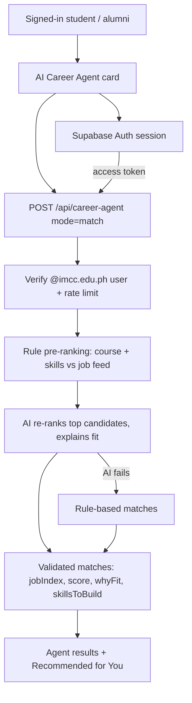

# IMCC Career Agent — structure and setup

## Recommended model

Use **`openai/gpt-oss-120b` on Groq** as the primary model. This project already uses Groq's OpenAI-compatible chat-completions endpoint and function calling, and the agent needs to reason about student profiles, search job data, and return structured recommendations. Groq currently lists GPT-OSS 120B as a production model with tool-use support. Use **`openai/gpt-oss-20b`** as the lower-cost/fallback option if you want to prioritize speed and budget over harder reasoning tasks.

Set these in **Vercel → Project → Settings → Environment Variables**:
- `GROQ_API_KEY` — required; create it in the Groq console. Never place it in HTML, `supabase-config.js`, or Git.
- `GROQ_MODEL` — optional; `openai/gpt-oss-120b`
- `GROQ_FALLBACK_MODEL` — optional; `openai/gpt-oss-20b`
- `ALLOWED_ORIGINS` — optional comma-separated list of additional exact origins if you use a custom domain.

After adding or changing environment variables, redeploy the Vercel project.

## Agent architecture

## Features

- **AI Career Agent (`mode: match`)** - reads the saved profile (course, skills, experience), pre-ranks the job feed with an explainable scoring function, then the model picks and explains the best 3-5 fits. Only real listings from the feed can be returned. If the AI call fails, the rule-based ranking is returned so the agent still works.
- **Recommended for You** - instant, local profile-based ranking (no API call); uses the AI results once the agent has run.
- **Profile feedback (`mode: profile-feedback`)** - strengths, improvements and a rewritten summary.

Removed: the Career AI chatbot, interview practice, "How ready am I?" and draft application message.

## Deploy checklist

1. Add `GROQ_API_KEY` in Vercel Environment Variables (Production, and Preview if needed).
2. Optionally set `GROQ_MODEL` / `GROQ_FALLBACK_MODEL`.
3. Redeploy.
4. Sign in with an `@imcc.edu.ph` account, complete the profile (course and skills), then press **Match me to jobs**.

## Limitations

- Matching only covers jobs loaded in the site (max 80 sent per request); it is not a live crawler and cannot guarantee a posting is still open.
- The rate limiter is in-memory per serverless instance (best-effort).
- AI output is advisory. Users should verify each posting with the employer.
